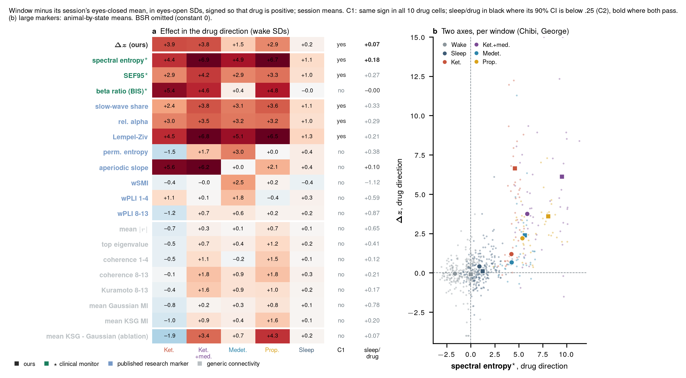

# Result: conventional metrics against Δz (26 November 2026)

Rule: [`preregs/bench-prereg.md`](preregs/bench-prereg.md), frozen before output (95972a1e). Code: [`bench.py`](bench.py), figure [`bench_fig.py`](bench_fig.py). Outputs: [`bench-score.json`, `bench-windows.csv.gz`, `bench.png`](../../../../results/representation/atlas-mi-pair-261117/bench/). Units as panel (c), signed so that drug is positive. Post hoc with respect to Δz, whose values were known.

Per metric in panel (c)'s construction: [`bench-grid.png`](../../../../results/representation/atlas-mi-pair-261117/bench/bench-grid.png) ([`bench_grid.py`](bench_grid.py)).

Both figures group metrics by literature tier (`bench_fig.TIERS`, set from the literature, not from these results). Starred are indices of, or components of, deployed depth-of-anaesthesia monitors: spectral entropy (GE Entropy), SEF95, and a band-truncated proxy of BIS's beta ratio. Next are published research markers of anaesthetic or conscious state, then generic connectivity summaries, then the ablation. There is no single best clinical index: BIS and Entropy are the deployed monitors, and BIS itself is not computed here.

## Verdict on the frozen criterion

- **Passing both C1 (same sign in all 10 drug cells) and C2 (sleep/drug ratio 90% CI below .25):** Δz (ratio .07 [.04, .11]) and spectral entropy (.18 [.15, .21]). Δz is not unique on the criterion.
- **Δz moves sleep least among the metrics that pass C1.** The session bootstrap of the ratio difference excludes 0 against every one of them: spectral entropy [.05, .15], Lempel–Ziv [.07, .21], SEF95 [.08, .31], relative alpha [.14, .32], slow-wave share [.15, .36]. Two sleep animals, so this is a session-level, not an animal-level, statement.
- **Near misses:** Lempel–Ziv fails C2 narrowly (.21 [.16, .26]). The BIS beta-ratio proxy and the aperiodic slope keep sleep at wake (ratios .00 and .10) but fail C1 on medetomidine (+0.4 and +0.0 wake SDs).
- **Every coupling metric fails C1.** Mean |r|, top eigenvalue, coherence, wPLI, Kuramoto order, wSMI and mean Gaussian or KSG MI all move ketamine opposite to propofol. So does mean K − G without a surrogate (−1.9 under ketamine, +4.3 under propofol). Δz is the only dependence measure here with one direction under all four agents.
- **Burst suppression was uninformative:** no 0.5-s segment fell below 25% of the session's eyes-closed median RMS, so it is constant.

## Drug against sleep: Δz does not beat the univariate indices

- **Window AUCs:** spectral entropy (1.00, 1.00) and Lempel–Ziv (1.00, .99) separate drug from sleep better than Δz (.93, .82) in Chibi and George.
- **At matched slow-wave share** (the overlap of drug and sleep ranges, slow-wave recomputed on the 32-channel subset):
  - Chibi: Δz .97 [.91, 1.00], from 19 ketamine and 1 medetomidine window against 15 sleep windows. This overlap is new; the stored all-channel fraction gave none.
  - George: Δz .44 [.19, .68], from 12 medetomidine, 4 ketamine and 1 propofol window against 8 sleep windows. Spectral entropy is .90 [.76, 1.00] and Lempel–Ziv .93 [.84, 1.00], so the null for Δz is not a power failure of the test.
- **Δz and the arousal indices are largely different axes.** Over windows, Δz correlates .17 with spectral entropy in wake and sleep and .20 in drug (Lempel–Ziv .16 and .22, slow-wave share .16 and .27). Sleep moves along spectral entropy only; drugs move along both (panel d).

## Reading

- What survives is specificity, not separation. Univariate spectral and complexity indices fall under every drug and also move sleep 18–33% of the way to drug, while separating drug from sleep better than Δz. Δz moves sleep 7% of the way, significantly less than any of them. Among dependence measures it alone moves the same way under all four agents.
- The supported wording is that Δz indexes a change in dependence that is largely independent of the arousal axis and absent in sleep. It is not a better drug–sleep classifier. In George, medetomidine at matched slow-wave share is not separated from sleep by Δz.
- BIS itself is not computed. It is proprietary, built for frontal scalp EEG, and its components need 30–47 Hz, while the bank is low-passed at 40 Hz. The beta-ratio proxy here rises under all four agents. BIS's beta ratio is described as falling with sedation (secondhand, primary text not read). So the proxy is not a BIS stand-in, and the reported BIS rise under ketamine cannot be tested here.
