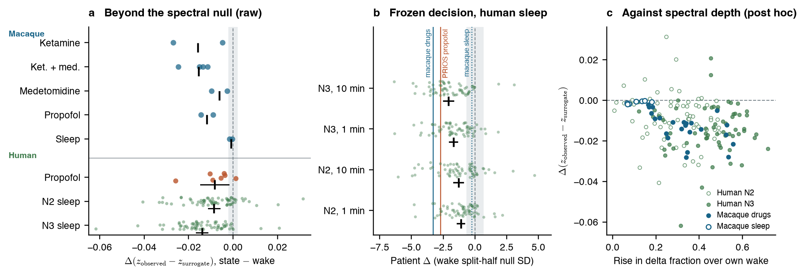

# Result: the MI pair does not stay at wake in human NREM sleep (MNI Open iEEG Atlas)

Read 27 November 2026 by the frozen rule of [`preregs/sleep-prereg.md`](preregs/sleep-prereg.md) (freeze commit `ca81b157`, which the job recorded in `commit.txt`). Gadi job 185372579 (`jobs/sleep.pbs`, 48 CPUs, walltime 1:50:31, exit 0, about 177 SU against 130 expected); data job 185368663 (`copyq`, 37 min, about 1 SU). Outputs: `/g/data/ql44/we2614/mts-spi-study/representation/atlas-mi-pair-261117/sleep/` (`result.txt`, `result.json`, `windows/`, `SHA256SUMS`). Data: the CC-BY-NC-4.0 NEMAR mirror nm000362 v1.0.2 of the atlas, fetched from NEMAR's public S3 remote with SHA-256 checks. No account was made on the origin portal, which now requires one with research-only terms. Whether the NEMAR copy is acceptable for this use, or portal access should be requested, is the user's decision.

## Verdict

**MOVES, for N3 (primary) and N2 (secondary).** In human natural NREM sleep, Δz (z(Gaussian MI, KSG MI), real minus joint IAAFT) falls by more than a quarter of the human anaesthesia effect. The 90% CI lies wholly beyond −.675 null SD. By the rule stated before the data were read, the "drug-specific, not arousal" claim fails in humans on this dataset. The macaque prediction (sleep at most about .1–.25 of the drug effect) is not met: in raw units human N3 equals the macaque drug mean and exceeds the PRIOS propofol effect.

| Contrast | n | Δ raw [90% CI] | Δ null SD [90% CI] | Down | Sign-flip p | / PRIOS SD, raw | / macaque SD, raw |
|---|---|---|---|---|---|---|---|
| N3 − wake | 64 | −.0140 [−.0165, −.0115] | −2.07 [−2.45, −1.70] | 62/64 | < 1e-5 | .77, 1.69 | .63, 1.05 |
| N2 − wake | 65 | −.0086 [−.0111, −.0061] | −1.28 [−1.65, −0.90] | 54/65 | < 1e-5 | .47, 1.03 | .39, 0.64 |

The precondition checks pass. Wake real z is .903 (ceiling .98), reliability is G .915 and K .761 (floor .3), and the N3 half-width is .37 null SD (limit .675). Null SD is .0068 (N3) and .0067 (N2) raw. The p is the floor of 200,000 Monte Carlo flips. The ratios are descriptive: PRIOS is 2-s CAR ECoG and the macaque is 10-s ECoG, so the units are approximate across datasets. One patient (sub-098) has 3 N3 windows, below the 10 required, and is out of the N3 contrast.

## Figure

`sleep/plot_sleep.py` (post hoc; reads the macaque `zns` arrays, PRIOS S-full `z.npz`, and this run's `result.json` and per-patient delta fractions, copied to `results/representation/atlas-mi-pair-261117/sleep/`).

- **(a)** Panel (c) of the MI figure with human rows added. It shows the raw change in z beyond the joint-IAAFT surrogate, state minus eyes-closed wake.
  - Macaque: one dot per animal; the tick is the session mean.
  - Human PRIOS propofol (S-full) and MNI N2 and N3: one dot per patient; the tick is the mean and the bar the t 90% CI.
  - Shading: the raw margin ±.0021.
- **(b)** The frozen decision: patient Δ in each contrast's wake split-half null SD, 10-min and processing-matched 1-min rows.
  - Shading: the ±.675 margin.
  - Reference lines: PRIOS propofol −2.7 (robust null SD), macaque drug session mean −3.29 and macaque sleep −0.24 (eyes-open SD). The units differ across datasets.
- **(c)** Post hoc: the unit's Δ (as in a) against the rise in delta fraction over that unit's own wake (0.5–4 Hz share of 0.5–40 Hz at 100 Hz). Macaque: one point per session, against eyes-closed wake. Human: one point per patient, N2 and N3 against wake. The rise is taken within each unit, so the montage-dependent level cancels.

## Reported rows (as frozen; not part of the verdict)

- **PRIOS null construction** (unscaled, 1.4826 MAD; .0070): N3 −2.01 [−2.38, −1.65], N2 −1.24 [−1.60, −0.87]. The unit choice does not change the reading.
- **Real against surrogate z.** The N3 fall is in real z: real −.0146, surrogate −.0006 (processing-matched 1-min clips: −.0176 against −.0029), so across states a matched IAAFT does not reproduce it. N2 is mixed: real −.0066, surrogate +.0020 (1-min: −.0033 against +.0062). This is a level decomposition across separate recordings. Within sleep the depth gradient runs through the surrogate instead (depth test below), so surrogate z is not a function of delta fraction alone, and only net is read as the effect. (Corrected 27 November: an earlier sentence here said the fall was "not the estimator responding to the sleep spectrum"; that holds only for this between-state comparison.)
- **Fisher z:** N3 −1.81 SD [−2.20, −1.42], N2 −1.19 [−1.57, −0.82].
- **Processing-matched 1-min clips**, with the same power-line step as wake:
  - N3 −.0147 raw, −1.68 SD [−1.98, −1.37], 60/65 down.
  - N2 −.0095 raw, −1.09 SD [−1.36, −0.82], 56/65 down.
  - Both are MOVES by the same rule, so the 10-min processing difference does not explain the effect.
  - In N2 1-min, most of the net fall is the surrogate rising (real −.0033, surrogate +.0062), unlike N3 1-min (real −.0176, surrogate −.0030).
- **Pairs sharing a contact excluded.** The raw fall is larger: N3 −.0253 [−.0307, −.0198], 57/64 down; N2 −.0149 [−.0200, −.0098], 47/65 down. Its own null SD is about 5× larger (.032), so in SD units N3 is −0.78 [−0.95, −0.61], which straddles the margin, and N2 is −0.47 [−0.62, −0.31], inside it. This is the main robustness caveat. The effect is not carried by adjacent same-electrode derivations; without them, the per-patient profile is much noisier.
- **Patients with ≥ 16 channels:** N3 −2.58 SD, n 40; N2 −1.89 SD, n 41.
- **Per centre, N3:**
  - G: −2.54 SD [−3.05, −2.03], 25/25 down.
  - M: −1.56 [−2.20, −0.92], 28/29 down.
  - N: −2.36 [−3.24, −1.48], 9/10 down.
  - The CI lies beyond the margin in every centre.
- **Protocol gates**, for the "sleep moves Δz" direction:

  | Gate | N3 | N2 |
  |---|---|---|
  | g1 sign-flip | p < 1e-5, pass | pass |
  | g2 \|Δ\| ≥ 3 null SD | −2.07, fail | −1.28, fail |
  | g3 split-half ≤ .25 \|Δ\| | .03, pass | .05, pass |
  | g4 | not applied | not applied |
  | g5 covariate-adjusted Δ | −.0058 of −.0140, fail | −.0010 of −.0086, fail |
  | g6 disattenuated Δ | −.0221, pass | −.0126, pass |

  On g5: within a patient, state is nearly collinear with the covariates. For N3, mean |r| is +14 SD, the top eigenvalue +9.6 SD and the delta fraction +23 SD. So the adjusted Δ is fragile in either direction and does not decide whether the fall is "coupling strength". The N3 adjusted Δ is still about 3 times the raw margin.
- **Conventional metrics**, N3 − wake in each metric's own null SD:
  - Slow-wave share and delta fraction +23.0; SEF95 −16.7; spectral entropy −32.0; LZc −30.4; permutation entropy −9.3.
  - Alpha −8.5; aperiodic slope +5.2; mean |r| +14.3; top eigenvalue +9.6.
  - Delta coherence and wPLI +3.4 and +1.9; alpha coherence and wPLI +2.1 and +1.1; alpha Kuramoto −0.2; wSMI −1.9; beta ratio −1.2.
  - Mean G +7.9, mean K +1.5, mean K − G −5.9; Δz −2.07.
  - N2 has the same pattern at smaller size, with mean K − G −0.0.
  - Burst-suppression ratio: N3 +2.7e-5 and N2 +5.3e-5 raw, undefined in null SD because the wake split-half null SD is 0. There is no suppression in any state.
  - So Δz is one of the smallest moves in the panel (about 1/10 of the spectral and complexity metrics), but it is not null.

## Post hoc descriptives (not in the prereg; `sleep/table.py`, `sleep/plot_sleep.py`; inferred)

- **Depth reached, as the within-unit rise in delta fraction over the unit's own wake** (medians):
  - Macaque sleep: +.11 (range .07–.18).
  - Macaque drugs: ketamine +.26, ketamine–medetomidine +.34, medetomidine +.30, propofol +.37.
  - Human N2: +.30 (IQR .21–.39).
  - Human N3: +.47 (.34–.55).
  - Absolute medians, for reference: human wake .34, N2 .63, N3 .79. They are not comparable with the macaque's absolute levels, because montages differ.
  - So the macaque sleep sessions were spectrally shallow, while human N2 is as deep as the macaque drugs and N3 is deeper.
- **A macaque depth line predicts the human result out of sample.**
  - Over all 30 macaque sessions (23 drug, 7 sleep), Δ = +.0011 − .0411 × rise (r −.72).
  - At the human median rise it predicts N2 −.0111 (observed −.0086) and N3 −.0182 (observed −.0140): right sign and order, about 25% too large.
  - Within macaque drug sessions alone, Δ still tracks depth (r −.54, n 23).
  - The five drug sessions with a sleep-like rise (< .2, all George) have Δ −.002 to −.009, near macaque sleep (−.001). This agrees with the George delta-matched check in `findings.md`.
- **Between human patients, Δ does not track the delta rise** (r −.01, n 64) or the change in mean |r| (r −.20). Per-patient Δ is dominated by wake noise (4–6 windows), which may mask a between-patient slope (inferred).
- **Reading (inferred, post hoc, cross-species):** Δz behaves as a readout of how far the state moves toward slow-wave dynamics, beyond what a stationary process with the same spectrum gives, not as a drug-specific signature. The macaque "drugs, not sleep" contrast compared deep drug states with shallow sleep. A plausible mechanism, not tested here, is the intermittent, non-Gaussian dependence of slow-oscillation up and down states (Steriade et al. 1993), which joint IAAFT does not keep.

## Depth-graded test (frozen; [`preregs/sleep-depth-prereg.md`](preregs/sleep-depth-prereg.md), freeze `731faea5`)

Question: inside sleep, does Δz fall with window delta fraction, and do N2 and N3 differ at equal delta? This is the necessary within-subject check of the post hoc depth reading. A drug against sleep comparison at matched depth needs both in the same subjects, which no dataset in hand has. Gadi job 185409700 (`jobs/sleep_depth.pbs`, 1 CPU, 39 s, exit 0; input checksums verified). Outputs are in `results/representation/atlas-mi-pair-261117/sleep/depth/`.

**Frozen outcome: no reading.** β (the slope on delta within state) is UNINFORMATIVE: its 90% CI half-width, .0106, exceeds the .0103 margin. γ (N3 − N2 at equal delta) is INCONCLUSIVE. None of readings A–F is earned; the nearest is D ("no claim").

| Row | β per unit delta [90% CI] | Neg | p | γ raw [90% CI] (n 52) |
|---|---|---|---|---|
| Primary (net) | −.0505 [−.0611, −.0399] | 62/64 | 5e-6 | +.0015 [−.0001, +.0032] |
| Adjusted (mean and SD of abs r, participation ratio, burst) | −.0286 [−.0405, −.0168] | 51/64 | 3e-5 | −.0011 [−.0025, +.0004] |
| Control (surrogate draw 1 as real) | +.0020 [−.0032, +.0071], FLAT | 29/64 | .54 | −.0004 [−.0015, +.0006], NO OFFSET |
| Real z alone | +.0236 [−.0097, +.0569] | 40/64 | .25 | −.0078 [−.0125, −.0032] |
| Surrogate z alone | +.0741 [+.0415, +.1067] | 27/64 | 1e-4 | −.0094 [−.0140, −.0048] |
| Within N2 only | −.0558 [−.0672, −.0445] | 59/64 | 5e-6 | – |
| Within N3 only | −.0399 [−.0648, −.0150] | 51/64 | .006 | – |
| Common delta range | −.0754 [−.0998, −.0510] (n 52) | 47/52 | 5e-6 | +.0017 [−.0002, +.0035] |
| Fisher z (sign and p only) | −.312 | 63/64 | 5e-6 | +.018 |

- **The rule's flaw (mine).** The UNINFORMATIVE-first order was copied from the equivalence test. It discards a CI that lies wholly beyond the margin when the CI is wide. Here the CI excludes the margin by about 4× and excludes zero (p 5e-6), but the half-width misses by 3%. The verdict stands as frozen. `analyse.verdict` has the same order; that is a protocol follow-up, not a fix here.
- **Descriptively (not by the rule):**
  - Δz falls with depth within sleep in 62/64 patients, in each stage separately.
  - The pipeline control is flat.
  - The coupling-strength covariates keep 57% of the slope. Depth and coupling strength are collinear within state (r ≈ +.6), so the two are not separated.
  - β is 1.23 × the macaque line slope.
- **γ does not support a stage account.** At equal delta, N3 is not below N2: the point estimate is above, and the lower bound is −.0001. β × the median delta gap (.164) gives −.0083 against the observed N3 − N2 difference of −.0055. The linear term over-predicts, consistent with a shallower slope in N3. "No offset" is not earned either.
- **The route caveat fired.** The prereg said that if β came from surrogate z rising rather than real z falling, the depth effect would be the estimator's response to the window spectrum. It did: surrogate z rises with delta (+.074), while real z rises less (+.024, not distinguishable from 0 or from the surrogate). I think that frozen sentence is too strong. Net measures dependence relative to a stationary process with the window's spectrum. "Real z gains less agreement than its spectrum predicts" is the same pattern `findings.md` counts as the effect for PRIOS propofol (real +.022, surrogate +.030). So the within-sleep gradient is a net effect beyond the spectrum by the anchor's definition, but it is not a fall in raw real z. Within sleep and from wake to N3 (real falls, surrogate flat), the route differs. Whether the two are one mechanism is open (inferred).
- **Bottom line (inferred).** The depth reading survived a test it could have failed descriptively (sign, both stages, control flat, no N3 offset), but it is not established by the frozen rule. It does not separate depth from coupling strength, and it says nothing about drug against sleep at equal depth.

## Deviations

None to the frozen analysis: the code, rules and rows are as frozen, and nothing else was tried on the primary data.

- The N2 and 1-min verdict lines in `result.txt` print "N3 shifts …" because the label is hard-coded in `analyse.verdict`. The rule was applied to each contrast's own numbers. The label is left unedited.
- The `analyse.py` report does not print the BSR row because its null SD is 0; it is given above from `result.json`.
- `table.py` and `plot_sleep.py` were added after the result was read. They only reformat frozen outputs and compute the post hoc descriptives and the figure.

## Limits (pre-stated, unchanged)

- **Day and setting differ.** Wake is a daytime, eyes-closed standardised recording; N2 and N3 come from the first night cycle. The split-half null cannot see this. A day/setting effect cannot be excluded as part of the fall; nothing here measures it.
- **No drug arm.** These patients have no drug arm, so there is no within-dataset positive control and no same-montage human anaesthesia effect to divide by.
- **Wake is short.** It is 4–6 windows, so each Δ is dominated by wake noise; the half-width rule was met nonetheless.
- **Patients and sampling.** All patients have epilepsy, only normal-appearing channels are used, and sEEG sampling is sparse. Without contact-sharing pairs, the effect in null-SD units is borderline.

## Per-patient table

Δ = mean net (state) − mean net (wake). SD = Δ / that contrast's null SD (N3 .00675, N2 .00671). Windows are wake/N2/N3 10-s windows. Centre is the source's code. Rows come from `table.py` on the frozen outputs.

| Patient | Centre | M | Windows W/N2/N3 | Wake z | N3 Δ raw | N3 Δ SD | N2 Δ raw | N2 Δ SD |
|---|---|---|---|---|---|---|---|---|
| sub-002 | G | 15 | 5/50/60 | 0.944 | -0.0118 | -1.75 | -0.0069 | -1.03 |
| sub-003 | G | 11 | 6/54/41 | 0.975 | -0.0149 | -2.21 | -0.0097 | -1.45 |
| sub-005 | G | 17 | 5/24/36 | 0.865 | -0.0104 | -1.55 | -0.0029 | -0.43 |
| sub-006 | G | 14 | 5/58/36 | 0.932 | -0.0313 | -4.63 | -0.0278 | -4.15 |
| sub-008 | G | 26 | 5/57/57 | 0.939 | -0.0218 | -3.23 | -0.0234 | -3.49 |
| sub-009 | G | 31 | 6/52/59 | 0.944 | -0.0073 | -1.09 | -0.0086 | -1.28 |
| sub-010 | G | 18 | 4/58/55 | 0.877 | -0.0319 | -4.73 | -0.0318 | -4.74 |
| sub-011 | G | 12 | 6/51/60 | 0.895 | -0.0329 | -4.87 | -0.0300 | -4.47 |
| sub-016 | G | 9 | 6/60/60 | 0.970 | -0.0006 | -0.09 | +0.0055 | +0.82 |
| sub-017 | G | 13 | 6/60/60 | 0.933 | -0.0145 | -2.15 | -0.0006 | -0.09 |
| sub-020 | G | 32 | 6/60/60 | 0.652 | -0.0429 | -6.36 | -0.0407 | -6.07 |
| sub-025 | G | 22 | 6/33/45 | 0.939 | -0.0206 | -3.06 | -0.0106 | -1.57 |
| sub-026 | G | 23 | 6/60/60 | 0.837 | -0.0044 | -0.66 | +0.0045 | +0.67 |
| sub-029 | G | 32 | 6/27/48 | 0.935 | -0.0066 | -0.98 | -0.0008 | -0.12 |
| sub-030 | G | 32 | 6/32/49 | 0.877 | -0.0186 | -2.75 | -0.0094 | -1.40 |
| sub-033 | G | 8 | 6/57/60 | 0.986 | -0.0016 | -0.24 | -0.0002 | -0.03 |
| sub-034 | G | 26 | 5/60/60 | 0.963 | -0.0141 | -2.09 | -0.0077 | -1.15 |
| sub-036 | G | 27 | 6/60/60 | 0.876 | -0.0172 | -2.54 | -0.0079 | -1.18 |
| sub-040 | G | 15 | 6/33/60 | 0.919 | -0.0187 | -2.77 | -0.0132 | -1.96 |
| sub-041 | G | 32 | 6/60/60 | 0.836 | -0.0239 | -3.54 | -0.0135 | -2.02 |
| sub-043 | G | 8 | 5/60/60 | 0.759 | -0.0115 | -1.70 | +0.0104 | +1.56 |
| sub-044 | G | 20 | 6/60/60 | 0.862 | -0.0139 | -2.06 | -0.0087 | -1.30 |
| sub-047 | G | 32 | 6/60/60 | 0.759 | -0.0221 | -3.27 | -0.0144 | -2.14 |
| sub-048 | G | 20 | 6/30/60 | 0.959 | -0.0167 | -2.47 | -0.0135 | -2.01 |
| sub-049 | G | 17 | 5/60/60 | 0.959 | -0.0244 | -3.61 | -0.0129 | -1.92 |
| sub-050 | M | 32 | 6/60/60 | 0.790 | -0.0001 | -0.01 | +0.0041 | +0.61 |
| sub-052 | M | 25 | 6/60/60 | 0.981 | -0.0054 | -0.80 | -0.0097 | -1.44 |
| sub-053 | M | 19 | 6/60/60 | 0.827 | -0.0049 | -0.72 | +0.0072 | +1.08 |
| sub-054 | M | 15 | 6/60/60 | 0.961 | -0.0068 | -1.00 | -0.0024 | -0.36 |
| sub-056 | M | 23 | 6/60/60 | 0.923 | -0.0180 | -2.66 | -0.0103 | -1.53 |
| sub-058 | M | 13 | 5/60/60 | 0.895 | +0.0208 | +3.08 | +0.0202 | +3.01 |
| sub-059 | M | 22 | 6/60/60 | 0.862 | -0.0271 | -4.02 | -0.0113 | -1.68 |
| sub-060 | M | 31 | 5/60/60 | 0.888 | -0.0163 | -2.41 | -0.0134 | -2.00 |
| sub-061 | M | 11 | 5/60/60 | 0.953 | -0.0162 | -2.39 | -0.0131 | -1.96 |
| sub-063 | M | 13 | 5/60/60 | 0.970 | -0.0012 | -0.18 | +0.0011 | +0.17 |
| sub-064 | M | 8 | 5/60/60 | 0.897 | -0.0618 | -9.15 | -0.0332 | -4.95 |
| sub-065 | M | 12 | 6/60/60 | 0.983 | -0.0077 | -1.14 | -0.0019 | -0.29 |
| sub-066 | M | 9 | 6/60/60 | 0.969 | -0.0085 | -1.26 | -0.0015 | -0.23 |
| sub-069 | M | 14 | 5/60/60 | 0.981 | -0.0040 | -0.58 | -0.0014 | -0.21 |
| sub-072 | M | 9 | 4/60/60 | 0.942 | -0.0035 | -0.52 | -0.0026 | -0.39 |
| sub-073 | M | 9 | 4/60/60 | 0.969 | -0.0071 | -1.05 | +0.0008 | +0.12 |
| sub-074 | M | 28 | 5/60/60 | 0.953 | -0.0165 | -2.45 | -0.0117 | -1.74 |
| sub-075 | M | 10 | 5/60/60 | 0.797 | -0.0096 | -1.43 | -0.0013 | -0.19 |
| sub-076 | M | 16 | 5/60/60 | 0.945 | -0.0033 | -0.48 | -0.0026 | -0.38 |
| sub-077 | M | 15 | 5/60/60 | 0.988 | -0.0055 | -0.81 | +0.0001 | +0.01 |
| sub-078 | M | 16 | 6/60/60 | 0.940 | -0.0224 | -3.32 | -0.0163 | -2.43 |
| sub-081 | M | 20 | 5/60/60 | 0.930 | -0.0167 | -2.47 | -0.0234 | -3.49 |
| sub-082 | M | 16 | 4/60/60 | 0.840 | -0.0080 | -1.19 | -0.0050 | -0.75 |
| sub-083 | M | 21 | 5/60/60 | 0.925 | -0.0031 | -0.45 | -0.0030 | -0.44 |
| sub-084 | M | 23 | 5/60/60 | 0.964 | -0.0164 | -2.42 | -0.0090 | -1.34 |
| sub-085 | M | 23 | 5/60/60 | 0.974 | -0.0134 | -1.98 | -0.0094 | -1.39 |
| sub-088 | M | 28 | 5/60/60 | 0.930 | -0.0038 | -0.57 | +0.0007 | +0.11 |
| sub-089 | M | 10 | 5/60/60 | 0.978 | -0.0007 | -0.11 | -0.0009 | -0.14 |
| sub-090 | M | 19 | 6/59/60 | 0.924 | -0.0082 | -1.21 | -0.0022 | -0.34 |
| sub-093 | N | 8 | 4/59/60 | 0.728 | +0.0124 | +1.84 | +0.0314 | +4.68 |
| sub-094 | N | 25 | 5/60/60 | 0.835 | -0.0155 | -2.30 | -0.0068 | -1.01 |
| sub-098 | N | 18 | 5/60/3 | 0.953 | – | – | -0.0158 | -2.35 |
| sub-099 | N | 19 | 5/60/60 | 0.847 | -0.0166 | -2.46 | -0.0190 | -2.83 |
| sub-100 | N | 32 | 5/60/59 | 0.839 | -0.0244 | -3.61 | -0.0184 | -2.74 |
| sub-103 | N | 32 | 5/60/60 | 0.899 | -0.0238 | -3.52 | -0.0193 | -2.88 |
| sub-106 | N | 32 | 6/54/36 | 0.882 | -0.0234 | -3.46 | -0.0224 | -3.34 |
| sub-107 | N | 29 | 5/60/60 | 0.851 | -0.0174 | -2.57 | -0.0144 | -2.15 |
| sub-108 | N | 25 | 5/60/60 | 0.830 | -0.0211 | -3.12 | -0.0113 | -1.68 |
| sub-109 | N | 23 | 5/60/60 | 0.858 | -0.0184 | -2.73 | -0.0319 | -4.76 |
| sub-110 | N | 10 | 6/60/60 | 0.921 | -0.0176 | -2.61 | -0.0028 | -0.41 |
