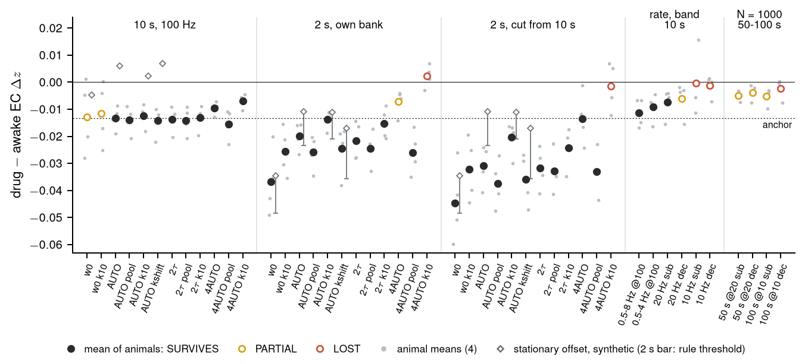
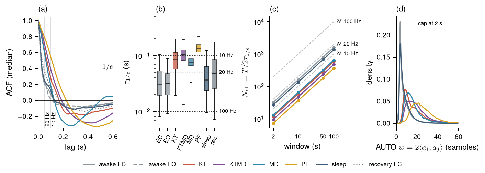

# Robustness of the MI-pair drug Δz: bias correction, Theiler window, k, window length, sampling rate

Prereg [`preregs/robust-prereg.md`](preregs/robust-prereg.md), frozen at 1f2c335b before any new real-data value was read. Code: [`robust.py`](robust.py), [`robust_acf.py`](robust_acf.py), [`robust_acf_fig.py`](robust_acf_fig.py), [`robust_spec_fig.py`](robust_spec_fig.py) (specification curve, from the text outputs only), [`robust_precise.py`](robust_precise.py) (unrounded values and the 2-s calibration rule). Jobs 185174153 (10 s) and 185174165 (2 s and calibration), snapshot `mi-robust-1f2c335b`. Outputs: `results/representation/atlas-mi-pair-261117/robust/` (`score10.txt`, `scoreS2.txt`, `scoreC2.txt`, `calib.txt`, `precise.txt`, `acf.txt`, `acf.{svg,pdf,png}`, `spec.{svg,pdf,png}`, `lowrate_summary.txt`, checksums); per-window arrays on gdata `.../atlas-mi-pair-261117/robust/`. Bias-correction rows are taken from [`ksg-bias-result.md`](ksg-bias-result.md). Rate and long-window rows come from the low-rate session (branch `claude/mi-pair-lowrate-3a8e2a`, prereg `preregs/lowrate-prereg.md` there, jobs 185156131/185158077), scored here read-only with its own `lowrate/summarise.py` from its snapshot `mi-lowrate-99cc8632`. The low-rate files were not edited.

## Summary

- **Gate passed (verified).** The 10-s AUTO, k = 4, ψ(T) z reproduces the stored `zns` within 2.5e-7. The new rows `auto k4 pool` and `2te k4 pool` reproduce kpool and k2te of `ksg-bias-result.md` exactly (R 1.07 and 1.08, t(3) −5.59 and −5.63).
- **Bias correction: SURVIVES** (kshift R 1.11, kpool 1.07, k2te 1.08).
- **Theiler window.** Exclusion is needed: with no exclusion (w = 0) the result is PARTIAL (3/4 animals down, t(3) −1.92). Every window with w > 0 SURVIVES at 10 s. The user's "strictly better" claim holds against w = 0 in own-SD magnitude and |t|, but not in the paired animal means. It fails as a monotone claim: under the frozen ψ(T) form, 4×AUTO is materially smaller than AUTO. Pool ψ reverses that.
- **k = 10: SURVIVES** (R .95, t(3) −5.98). It is also the better configuration on drug-blind calibration.
- **Window length.** At 2 s the fall SURVIVES in both arms under AUTO and kshift. By the frozen calibration rule, the 2-s own bank is not distinguished from the estimator's response to drug spectra. The 2-s cuts of the 10-s windows pass, kshift only just (−2.04 SE).
- **Sampling rate.** At a fixed 10 s and the same 0.5–8 Hz band, 20 Hz keeps .53 of the 100 Hz fall (L20 → D20; N also falls 5×). The matched-N arms (50–100 s) keep .18–.39, but they also lengthen the window: at fixed 20 Hz, 10 → 50 s keeps .63–.68, while at fixed 10 Hz, 10 → 100 s raises it (.03 → .39 S, .09 → .18 D), so they do not isolate rate and the duration direction depends on rate (inferred; four-animal ratios, N also changes). Low-pass filtering to the same band at 100 Hz keeps .69–.85. Keep 100 Hz. Keep 10 s against 2 s on the T = 200 calibration; against longer windows at 100 Hz there is no evidence either way. By the ACF 100 Hz oversamples the decorrelation time, but this estimator uses the extra samples.
- **The user's expectation** that these checks "won't hurt" holds for bias correction, k and the Theiler window with w > 0 (10 of 10 such configurations SURVIVE at 10 s, 100 Hz). It does not hold for removing the exclusion, for the 2-s own bank under the calibration rule, or for lowering the sampling rate.

## Consolidated table

Specification curve (`spec.png`). Each column is one configuration: grey dots are the four animal means, the large marker is their mean, coloured by the verdict rule below. Diamonds are the drug-blind stationary drug − awake offset from the synthetic calibration for the same configuration and window length (T = 1000 at 10 s, T = 200 at 2 s). At 2 s a bar runs down to the frozen rule's threshold (offset − 2 SE); a real value must sit below its end to pass. No rule was frozen at 10 s, so those diamonds have no bar. All 2-s configurations are shown, not only the four in the table. The y value here is the mean of animal means for every row, so 10-s R values read off the figure differ slightly from the session-pooled R in the table (w = 0: .98 here, .82 in the table; its shortfall is consistency across animals, not mean size).

Pooled drug Δz is normal-scored z real − IAAFT surrogate, drug − awake eyes-closed. In parentheses it is given in the configuration's own eyes-open session SD. R is pooled Δz over the reference. Animals: number of animal means < 0 out of 4, with one-sided t(3) and p. Agents: the sign of each drug agent's mean, KT/KTMD/MD/PF. Sleep: Δz (own SD, sessions down). Verdicts follow the ksgbias rule: SURVIVES needs 4/4 animals, p < .05, every agent < 0 and R ≥ .5; LOST is R < .25 or ≤ 2/4 animals; PARTIAL is anything else.

The rb and ksgbias rows pool over drug sessions, as `robust.py`, with reference −.0133. The low-rate rows pool over animal means, as `summarise.py`, with reference −.0132. R is computed only within one definition.

| Axis | Configuration | Pooled drug Δz | R | t(3), p | Animals | Agents | Sleep Δz | Verdict |
|---|---|---|---|---|---|---|---|---|
| anchor | 10 s, 100 Hz, AUTO, k = 4, ψ(T) | −.0133 (−6.7) | 1.00 | −6.11, .0044 | 4/4 | − − − − | −.0010 (−0.5, 7/7) | SURVIVES |
| bias | kshift (primary of ksgbias) | −.0148 | 1.11 | −5.73, .0053 | 4/4 | − − − − | −.0007 (5/7) | SURVIVES |
| bias | kpool (= AUTO, pool ψ) | −.0142 (−6.6) | 1.07 | −5.59, .0056 | 4/4 | − − − − | −.0010 (−0.5, 7/7) | SURVIVES |
| bias | k2te (= 2τ₁/ₑ, pool ψ) | −.0143 (−6.7) | 1.08 | −5.63, .0056 | 4/4 | − − − − | −.0009 (−0.4, 7/7) | SURVIVES |
| Theiler | w = 0, k = 4 | −.0109 (−4.9) | .82 | −1.92, .076 | 3/4 | − − − − | −.0023 (−1.1, 7/7) | PARTIAL |
| Theiler | 2τ₁/ₑ, k = 4 | −.0140 (−6.2) | 1.05 | −5.70, .0054 | 4/4 | − − − − | −.0008 (−0.4, 6/7) | SURVIVES |
| Theiler | 4×AUTO, k = 4 | −.0096 (−4.0) | .72 | −7.89, .0021 | 4/4 | − − − − | −.0017 (−0.7, 6/7) | SURVIVES; paired +3.80 |
| Theiler | 4×AUTO, k = 4, pool ψ | −.0159 (−6.8) | 1.19 | −5.53, .0058 | 4/4 | − − − − | −.0009 (−0.4, 7/7) | SURVIVES; paired −2.73 |
| k | AUTO, k = 10 | −.0126 (−7.5) | .95 | −5.98, .0047 | 4/4 | − − − − | −.0009 (−0.6, 7/7) | SURVIVES; paired +3.56 |
| k | w = 0, k = 10 | −.0096 (−4.6) | .72 | −1.94, .074 | 3/4 | − − − − | −.0018 (−0.9, 7/7) | PARTIAL |
| k | 2τ₁/ₑ, k = 10 | −.0134 (−6.4) | 1.01 | −5.57, .0057 | 4/4 | − − − − | −.0007 (−0.3, 6/7) | SURVIVES |
| k | 4×AUTO, k = 10 | −.0070 (−2.7) | .53 | −5.44, .0061 | 4/4 | − − − − | −.0016 (−0.6, 5/7) | SURVIVES (marginal) |
| 2 s, own bank | AUTO, k = 4 | −.0202 (−3.9) | 1.00 [1.52] | −7.54, .0024 | 4/4 | − − − − | −.0006 (−0.1, 5/7) | SURVIVES; calibration rule fails (−1.5 SE) |
| 2 s, own bank | kshift | −.0261 (−4.0) | 1.29 [1.96] | −5.24, .0068 | 4/4 | − − − − | −.0007 (−0.1, 4/7) | SURVIVES; calibration rule fails (−1.0 SE) |
| 2 s, own bank | w = 0, k = 4 | −.0351 (−5.1) | 1.74 | −5.89, .0049 | 4/4 | − − − − | −.0034 (−0.5, 6/7) | equal to the stationary offset (−0.1 SE) |
| 2 s, cut | AUTO, k = 4 | −.0312 (−9.2) | 1.00 [2.35] | −8.04, .0020 | 4/4 | − − − − | −.0043 (−1.3, 6/7) | SURVIVES; calibration rule passes (−3.2 SE) |
| 2 s, cut | kshift | −.0360 (−9.6) | 1.15 [2.71] | −7.52, .0024 | 4/4 | − − − − | −.0056 (−1.5, 7/7) | SURVIVES; calibration rule passes, knife-edge (−2.04 SE) |
| 2 s, both | 4×AUTO, k = 10 | +.0015 / −.0049 | −.07 / .16 | +1.06 / −0.32 | 1/4, 2/4 | mixed | — | LOST |
| rate, 10 s | 0.5–8 Hz at 100 Hz (L20), N 1000 | −.0113 (−4.6) | .85 | −4.30, .012 | 4/4 | − − − − | −.0011 (−0.4, 7/7) | SURVIVES |
| rate, 10 s | 0.5–4 Hz at 100 Hz (L10), N 1000 | −.0091 (−2.8) | .69 | −3.59, .019 | 4/4 | − − − − | −.0022 (−0.7, 7/7) | SURVIVES |
| rate, 10 s | 20 Hz subsampled (S20), N 200 | −.0074 (−1.0) | .56 | −2.74, .036 | 4/4 | − − − − | −.0011 (−0.1, 6/7) | SURVIVES |
| rate, 10 s | 20 Hz decimated (D20), N 200 | −.0060 (−1.5) | .45 | −1.88, .078 | 4/4 | − − − − | −.0001 (−0.0, 3/7) | PARTIAL |
| rate, 10 s | 10 Hz subsampled (S10), N 100 | −.0004 (−0.1) | .03 | −0.06, .48 | 3/4 | − + − − | +.0041 (+0.7, 3/7) | LOST |
| rate, 10 s | 10 Hz decimated (D10), N 100 | −.0012 (−0.2) | .09 | −0.63, .29 | 1/4 | − + − − | −.0013 (−0.2, 5/7) | LOST |
| long | 50 s @ 20 Hz, subsampled (S20L), N 1000 | −.0050 (−1.7) | .38 | −5.71, .0053 | 4/4 | − − − − | −.0010 (−0.4, 5/7) | PARTIAL |
| long | 50 s @ 20 Hz, decimated (D20L), N 1000 | −.0038 (−1.6) | .29 | −2.68, .037 | 4/4 | − − + − | −.0015 (−0.6, 6/7) | PARTIAL |
| long | 100 s @ 10 Hz, subsampled (S10L), N 1000 | −.0051 (−1.7) | .39 | −3.24, .024 | 4/4 | − − − − | −.0008 (−0.3, 3/6) | PARTIAL |
| long | 100 s @ 10 Hz, decimated (D10L), N 1000 | −.0024 (−0.6) | .18 | −1.35, .135 | 3/4 | − − + − | −.0034 (−0.8, 5/6) | LOST |

- **Paired** is the animal-level paired t(3) of configuration − AUTO k4. ≥ +2.35 means AUTO's animal means are materially more negative; ≤ −2.35 the reverse. This measures consistency across the four animals, not size. AUTO k = 10 trips +3.56 on a 5% smaller raw Δz whose own-SD effect is larger.
- **2-s R values** are against the same arm's AUTO k4. Values in brackets are against the 10-s anchor.
- **4×AUTO k = 10 at 2 s** is LOST in both arms: own bank +.0015 (1/4 animals), cut −.0049 (2/4). Its sleep Δz is −0.5 SD in both.
- **Verdicts on the low-rate rows** use this document's rule. The low-rate prereg's own reading is a band comparison, D against S at the same N and duration, normal-scored:
  - D20/S20: band-neutral (B .81).
  - D10/S10: inconclusive.
  - D20L/S20L: band-neutral (B .76, paired t(3) +2.04).
  - D10L/S10L: weaker in the slow band (B .47, t(3) +9.61).
  - No arm trips its control flag (eyes-open or sleep beyond 2 own SD).
- **Specification count at 10 s, 100 Hz.** Of 12 configurations (11 rb10 rows and kshift), the 10 with w > 0 SURVIVE, the 2 with w = 0 are PARTIAL, and none is LOST.

## Autocorrelation and sampling rate (descriptive)

The figure uses the normal-scored 10-s windows and the 32-channel subsets the estimator sees.
- (a) Median ACF of unit-averaged channels, lag in seconds. Grey lines mark the sample spacing at 20 Hz and 10 Hz.
- (b) τ₁/ₑ per window and channel, with the 100, 20 and 10 Hz sample spacing marked.
- (c) N_eff = T/(2τ₁/ₑ) at the median τ against window length. Dashed lines are raw N at each rate.
- (d) The uncapped AUTO window 2⟨a_i, a_j⟩ per pair, in samples at 100 Hz. The 2-s cap is 20; the 10-s cap is 100.

Per window × channel (verified, `acf.txt`):

| State | τ₁/ₑ median [IQR] (s) | Envelope τ (s) | Integral to first zero (s) | ACF at 2τ₁/ₑ | First zero (s) | AUTO w median (samples) | AUTO ≥ 20 |
|---|---|---|---|---|---|---|---|
| awake EC | .031 [.019, .053] | .032 | .040 | +.064 | .12 | 5.4 | .04 |
| awake EO | .032 [.020, .048] | .033 | .038 | +.073 | .10 | 5.2 | .00 |
| KT | .085 [.058, .115] | .097 | .075 | −.039 | .17 | 13.9 | .29 |
| KTMD | .105 [.081, .126] | .130 | .092 | −.103 | .19 | 17.6 | .40 |
| MD | .077 [.066, .088] | .207 | .068 | −.166 | .13 | 14.3 | .24 |
| PF | .138 [.116, .159] | .459 | .116 | −.165 | .23 | 23.2 | .64 |
| sleep | .037 [.023, .064] | .038 | .045 | +.062 | .13 | 6.3 | .04 |
| recovery EC | .048 [.026, .085] | .051 | .055 | +.075 | .17 | 7.5 | .06 |

**The decay is not exponential (verified).**
- Awake and sleep ACFs are below e⁻² ≈ .135 at 2τ₁/ₑ, so they decay faster than exponential. The fitted e-folding time over lags up to τ₁/ₑ is 10–20% above τ₁/ₑ. Log-ACF is concave near 0, as expected for a band-limited, smooth signal (inferred).
- Drug ACFs are already negative at 2τ₁/ₑ and reach a lobe of −.2 to −.3 by 0.3–0.5 s (panel a). This is quasi-periodic delta, so τ₁/ₑ there is about a quarter-period, not a decay time, and 2τ₁/ₑ lands past the first zero.
- The prereg's oscillation flag is 1.00 in every state and does not discriminate, so the first zero and the lobe are reported instead.
- Where the ACF oscillates, the envelope τ (1/e crossing of max |ACF| at that lag or later) is the decay time of the oscillation's amplitude. Under drug it is 1.1× (KT) to 3.3× (PF) τ₁/ₑ; awake and sleep envelope τ equals τ₁/ₑ. Under PF the AUTO window (median 23 samples, .23 s) is shorter than the envelope time (.46 s); 4×AUTO (drug median 68 samples, .68 s) covers it, and that configuration still SURVIVES.
- The AUTO window 2⟨a_i, a_j⟩ is a Bartlett-type pair decorrelation length: it sums the product of the two ACFs over all lags. That makes it the better-founded Theiler choice for a pair statistic, compared with a single channel's 1/e time.

**τ in samples at 100/20/10 Hz.** Awake 3.1/0.6/0.3; KTMD 10.5/2.1/1.05; PF 13.8/2.8/1.4. The decorrelation rate 1/(2τ₁/ₑ) is about 16 Hz awake and 3.6–6.5 Hz under drug. By this criterion, 100 Hz oversamples the decorrelation time about 6× awake and 15–27× under drug, though not the 40 Hz analysis band. Because τ₁/ₑ is a quarter-period under drug, the envelope τ gives the more conservative drug figures: 1/(2τ_env) is about 1–5 Hz (PF 1.1, MD 2.4, KTMD 3.8, KT 5.2), and N_eff in the table below drops to the envelope values in brackets.

**N_eff = T/(2τ₁/ₑ) at the median τ**

| Window | Awake | KTMD | PF | Raw N at 100 / 20 / 10 Hz |
|---|---|---|---|---|
| 2 s | 32 | 9.5 [7.7] | 7.2 [2.2] | 200 / 40 / 20 |
| 10 s | 161 | 48 [38] | 36 [11] | 1000 / 200 / 100 |
| 50 s | 806 | 238 [192] | 181 [54] | 5000 / 1000 / 500 |
| 100 s | 1613 | 476 [385] | 362 [109] | 10000 / 2000 / 1000 |

- Pair-level T/w_AUTO at 10 s: awake 185, KTMD 57, PF 43.
- **Theiler w in use.** At 10 s the median AUTO w is 5 (awake) and 17 (drug); the cap of 100 is never reached. At 2 s the in-window AUTO is shorter, median 4 and 10: the ACF estimated from 200 samples is shorter than at 10 s. The cap of 20 binds for 7% of drug edges in the own bank and 18% in the cuts. 2τ₁/ₑ reaches the cap for 29% and 67%.
- **The user's concern** that the Theiler window leaves too few samples applies only at 2 s with large windows. With 4×AUTO and k = 10 at 2 s, 40–48 of 200 samples are excluded on each side and the result is LOST in both arms. Calibration predicted this without reference to the drug: at T = 200, detectability is ≤ 0.75 for every 4×AUTO configuration under ψ(T) (≤ .93 with pool ψ).

**Squaring the ACF with the rate arms.**
- The N_eff argument predicts that subsampling 100 → 20 Hz costs little: drug τ is about 2 samples at 20 Hz, so N_eff barely changes. Empirically it costs about half the effect.
- L20 against D20 is the same band (0.5–8 Hz) and the same 10 s, with N 1000 against 200: R .85 against .45.
- Restoring N = 1000 by lengthening the window at 20 Hz (S20L, 50 s) does not restore the magnitude (R .38, below S20's .56), although t(3) improves (−5.71).
- **Correction (after the low-rate session's duration bullet, 922a67f9 on its branch).** That comparison changes duration with N. At fixed 20 Hz, 10 → 50 s keeps .63 (D) and .68 (S) of Δz, so at 20 Hz longer windows give a smaller Δ. At 10 Hz the reverse: 10 → 100 s raises S from .03 to .39 and D from .09 to .18. These are ratios of four-animal means with no test of the difference, and N changes 5–10× with duration, so the duration reading is inferred and rate-dependent. Decomposed over L20, D20, D20L (same band): rate at fixed 10 s keeps .53 (N confounded), duration at fixed 20 Hz keeps .63, product .34. Rate and N at fixed duration, and duration at 100 Hz, are not separated by any computed arm.
- So N_eff does not explain the loss at fixed duration, and the matched-N arms do not test rate alone. Longer windows also add nonstationarity over 50–100 s, which IAAFT does not model.
- The mechanism is unknown. A candidate (speculation) is that KSG's local-density resolution depends on sample density within each ~1-s excursion, which subsampling thins and longer windows do not restore.

**Sampling-rate recommendation.** Keep 100 Hz.
- The 1/e decorrelation criterion (and its 2× variant) would choose 10–20 Hz. For this estimator that loses .44–.97 of the effect at 10 s.
- Low-pass at 100 Hz shows the effect is mostly below 8 Hz (L20 .85) and partly below 4 Hz (L10 .69). A slower rate is a choice of band and of sample density, not a free saving.
- The decorrelation time should set the Theiler window (AUTO), not the sampling rate.

## Verdicts by axis

**Bias correction: SURVIVES (verified, [`ksg-bias-result.md`](ksg-bias-result.md)).** The rows are reproduced here exactly. At T = 1000 the calibration's stationary drug − awake offset is positive for AUTO k4 (+.0061 ± .0035) and kshift (+.0068 ± .0044). So the estimator's response to drug spectra alone is not negative in this configuration (+1.5 to +1.8 SE), against the observed fall.

**Theiler window, against the frozen reading of the user's claim**
- **"Won't remove the effect."** The frozen reading (SURVIVES at every w, w = 0 included) fails literally at w = 0, which is PARTIAL (one animal at +.0012; KTMD 9/11 sessions down), against my prediction that it would survive. The failure is in the direction of the user's claim: every w > 0 (AUTO, 2τ₁/ₑ, 4×AUTO, at k = 4 and k = 10) SURVIVES, so the exclusion is what makes the effect consistent across animals.
- **AUTO against w = 0.**
  - Magnitude: −6.7 against −4.9 own EO SD. AUTO is better.
  - Strength: |t(3)| 6.11 against 1.92. AUTO is better.
  - Paired animal means: t(3) +0.05, so not materially. The mean fall is similar; w = 0 adds animal-to-animal noise.
- **Longer windows.**
  - 2τ₁/ₑ is neither better nor worse than AUTO: R 1.05, |t| −7%, paired −1.43.
  - 4×AUTO under the primary ψ(T) is materially smaller (R .72, own SD −4.0, paired +3.80) but has larger |t| (7.89).
  - Under pool ψ the same window is materially larger (R 1.19, paired −2.73).
- **So "strictly better", as frozen** (AUTO beats w = 0 and no longer window is materially worse), **fails** at 4×AUTO under ψ(T). The failure depends on the ψ convention, so it is not a finding about temporal exclusion itself.
- **Drug-blind support (verified, `calib.txt`).** At T = 1000, 4×AUTO under ψ(T) loses sensitivity to known non-Gaussian dependence (detectability .11/1.34/.60 for awake/KTMD/PF spectra, against .35/3.17/1.27 at AUTO). Pool ψ restores it (.52/2.41/1.55).
- **Inferred mechanism, not checked on the rb10 arrays.** ψ(T) ignores the excluded pool, which leaves an edge-varying offset of about 2w/T (+.13 at the drug median w = 68). Whether that offset is what reduces z is untested.
- **Reading.** Exclusion matters; AUTO and 2τ₁/ₑ sit on a plateau; beyond it the answer depends on the estimator's ψ form.

**k: SURVIVES (verified).** AUTO k = 10 gives R .95 and t(3) −5.98, with own-SD −7.5 against −6.7. The paired +3.56 reflects a consistent 5% shrink, not a loss.

**Window length**
- **2 s, all four SURVIVES conditions.** Met under AUTO and kshift in both arms (t(3) −5.2 to −8.0). This answers the user's "more, shorter windows" in sign and significance.
- **Magnitude is not the same.** The raw Δz is 1.5× (own bank) to 2.3× (cut) the 10-s value, against my predicted .5–1.0. Awake z itself shifts (real .89 against .97), so z is not T-invariant.
- **Frozen calibration rule.** The real 2-s Δz must exceed the T = 200 stationary drug − awake offset by more than 2 SE under the same configuration.
  - Own bank fails: AUTO −1.5 SE, kshift −1.0 SE.
  - Cut passes: AUTO −3.2 SE; kshift −2.04 SE, inside rounding of the threshold. The pass holds under both pooling definitions (sessions −.03596, animal means −.03593, against the threshold −.03560).
  - So the 2-s own-bank arm is not cited as robustness, and the cut arm is cited with the knife-edge noted.
  - At T = 200 the offset is negative (AUTO −.011, kshift −.017, w = 0 −.035). Short windows make the estimator respond to drug spectra in the drug direction; at 10 s it does not.
  - Limits of the rule: the calibration has 16 channels, uses only KTMD and PF drug spectra, and has n = 40 per cell.
- **w = 0 at 2 s.** The real Δz (−.0351) equals the calibration offset (−.0346), so its R of 1.74 is the estimator's response, not drug-specific. At short windows the Theiler window protects validity, not magnitude.
- **Sleep in the cut arm.** Sleep is −1.3 to −1.5 own SD with 6–7/7 sessions down. It is not at control level the way it is at 10 s (−0.5 SD), though still about a seventh of drug.
- **Net of the stationary offset (inferred; assumes the synthetic offset adds to the real Δz).** 2-s cut: AUTO −.0203, kshift −.0189, k10 −.0102. 2-s own bank: −.0093, −.0090, −.0029. The T = 200 offsets carry SE .005–.009 on these nets of about .01–.02. The ratio to 10 s depends on whether the +.002 to +.007 offset at T = 1000 (+1.1 to +1.8 SE from zero) is also subtracted: with it, cut 1.05/.88/.68 and own bank .48/.42/.19 (10-s nets −.0194/−.0216/−.0149); without it, cut 1.53/1.28/.81 and own bank .70/.61/.23. Either way most of the cut arm's raw 2.35× is the estimator's short-window response; net of it the cut arm is 0.7–1.5× and the own bank 0.2–0.7× the 10-s size. The offsets come from a 16-channel generator with two drug spectra.
- **Longer windows** exist only at reduced rates (50 s at 20 Hz, 100 s at 10 Hz) and are discussed under sampling rate. No 50-s window at 100 Hz was computed, so duration at 100 Hz above 10 s is untested.

**Sampling rate: the effect shrinks at 20 and 10 Hz in 10-s windows (verified, low-rate session); whether at matched N it is rate or duration is open.** See above. Keep 100 Hz: every rate or band arm is smaller than the anchor. Keep 10 s: 2-s windows give larger raw Δz but a negative stationary offset, and the own bank fails the calibration rule; 100 Hz windows longer than 10 s are untested.

## Drug-blind configuration choice

Calibration (`calib.txt`, `precise.txt`; synthetic, 16 channels, real spectra):
- At T = 1000, k = 10 has smaller stationary drug − awake offsets than k = 4 (AUTO +.0023 ± .0020 against +.0061 ± .0035) and higher detectability (1.95/3.65/1.55 against .35/3.17/1.27).
- w = 0 at k = 10 has the highest detectability of any row (3.13/3.66/2.65) and an offset of −.0029 ± .0022, in the drug direction.
- At T = 200 every configuration has detectability ≤ 2.5. The w = 0 offset is −.035, so 2-s windows are a poor regime for this estimator.
- Detectability has no SE and does not penalise offsets, so it cannot rank configurations on its own.

On these drug-blind grounds, plus Theiler's (1986) argument for excluding temporal neighbours, the defensible configuration is 10 s at 100 Hz, AUTO (or 2τ₁/ₑ) exclusion and k = 10 (or k = 4 with kshift). Under that choice the real result is R .95, t(3) −5.98, SURVIVES. It was chosen without reference to the drug effect, and every neighbouring configuration with w > 0 at 10 s, 100 Hz also SURVIVES. Reporting the full table above as a specification curve (Steegen et al. 2016, Perspect. Psychol. Sci. 11:702; Simonsohn, Simmons & Nelson 2020, Nat. Hum. Behav. 4:1208) is preferable to choosing a single configuration.

## Predictions against outcome

| Prediction (prereg) | Outcome |
|---|---|
| w = 0 survives, R .6–1.2, \|t\| below AUTO but not materially | R .82 and \|t\| 1.92 as predicted, paired +0.05; but PARTIAL (3/4 animals): **failed** on survival |
| 2τ₁/ₑ and 4×AUTO: R .85–1.15, \|t\| within ±15% | 2τ₁/ₑ: R 1.05, −7%, as predicted. 4×AUTO: R .72 and \|t\| +29%, **failed** (pool ψ R 1.19, also outside) |
| k = 10: R .8–1.2 | .95, as predicted |
| 2-s own bank: kshift R .7–1.2 against 2-s k4; own-SD effect below 10 s; calibration rule the real risk | R 1.29, **failed** (just above). Own-SD −4.0 against −6.7, as predicted. Calibration rule failed, as flagged |
| 2-s cut: raw Δz .5–1.0 of 10 s; own-SD closer to 10 s | raw 2.35×, **failed**; own-SD −9.2 against −6.7 (larger, not closer) |

## Paragraph for the paper (draft)

The drug-related fall in z(G, K) did not depend on the bias correction or on the temporal-exclusion window of the kNN estimator, provided temporally adjacent samples were excluded. In 10-s windows at 100 Hz, every configuration with a Theiler window (the pair-decorrelation window, twice the 1/e time or four times the pair window; k = 4 or 10; ψ(N) or pool-adjusted digamma; or a circular-shift bias correction; 10 configurations) gave a negative drug Δz in all four animals and for every drug agent (t(3) = −5.4 to −7.9, p ≤ .0061; .53–1.19 of the reference magnitude), with sleep within 0.7 eyes-open SD of eyes-closed wakefulness. Without exclusion the mean fall was similar (.82 of reference) but held in only three of four animals (t(3) = −1.9). In 2-s windows cut from the same recordings the fall persisted (t(3) = −7.5 to −8.0) and exceeded the estimator's response to drug spectra in stationary synthetic data by 2.0–3.2 SE; in an independent 2-s bank it did not exceed that response. Lowering the sampling rate to 20 or 10 Hz in 10-s windows reduced the fall (to .03–.56 of reference), whereas low-pass filtering to the same bands at 100 Hz kept .69–.85; lengthening 20 or 10 Hz windows to 50–100 s to restore 1,000 samples did not recover it (.18–.39), although at these rates window duration and sample count change together. The effect therefore lies mostly below 8 Hz (provisional, pending the band-pass arms) and is largest at 100 Hz among the sampling rates tested; we analyse at 100 Hz in 10-s windows with the pair-decorrelation Theiler window.

## Limits

- Each axis is varied from the anchor, with one surrogate draw per window, 32-channel subsets and four animals.
- The reference is held fixed: common average, one channel dropped. The surrogate is a joint IAAFT draw that keeps each pair's cross-spectrum, so zero-lag linear mixing enters real and surrogate alike; a different reference can still change the non-Gaussian part and the edge profile z is taken over. Bipolar derivations are possible from the provider's electrode maps (as in [`neurotycho-source-pilot.md`](../../neurotycho/notes/neurotycho-source-pilot.md)) but are untested here.
- Window placement within the drug interval is not varied. The ten 10-s drug windows are spread evenly over the labelled Anesthetized interval, which starts 4.5–14.7 min after the injection label in the six locally audited archives. They span about 7–11 min of it for KT and PF, 10–18 min for MD and 20–32 min for KTMD, so time under drug is confounded with agent.
- The low-rate long arms confound duration with rate (and, for the D arms, with band). The missing cells are 100 Hz on 50-s windows at 0.5–40 and 0.5–8 Hz.
- The 2-s calibration rule rests on a 16-channel synthetic generator using two drug spectra.
- The ψ(T) mechanism at 4×AUTO is inferred, not tested.
- The low-rate session's low-pass, high-pass and band-pass ladders (jobs 185180701–3, prereg `bands-prereg.md` on its branch) were running at the last check (25 Nov, about 20 min into 5 h); "mostly below 8 Hz" rests on L20/L10 alone until they land.
- The rb arrays (about 450 MB) stay on gdata. The text outputs here are what the numbers above are read from. `robust_precise.py` was run from a temporary copy in the snapshot's mi_pair folder.
