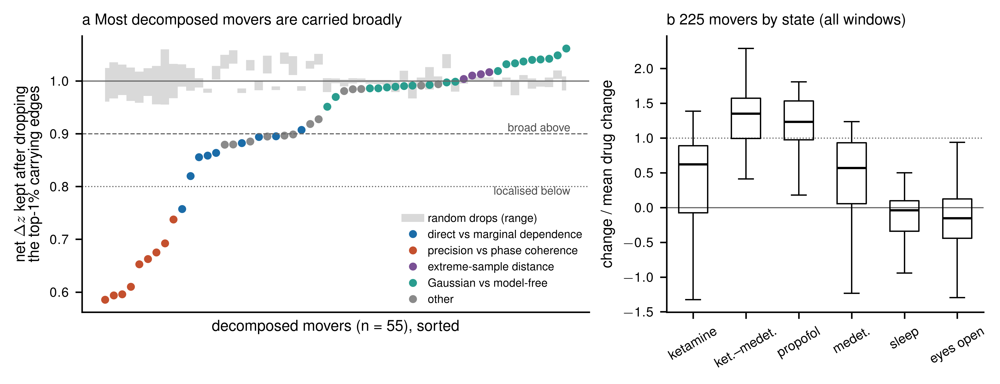

# Result: whole-atlas movers beyond the spectral null, and their edge carriers (critic 1, 17 November 2026)

- **Rule:** [prereg.md](prereg.md), with Revision 1. The code and scorer were frozen and checksum-verified before scoring (`code.sha256`). Post hoc checks are `movers_posthoc.py`, written after scoring and labelled as such below.
- **Gadi:**
  - phase 1, job 184254543 (seconds);
  - phase 2, job 184254544 (21 SU, 13 min). Phase 2 used 95.3 of 96 GB, so give a rerun more memory.
- **Outputs:**
  - gdata `/g/data/ql44/we2614/mts-spi-study/representation/atlas-movers-261117/`;
  - scores, post hoc checks and the figure in `results/representation/atlas-movers-261117/`.
- **Arm:** NeuroTycho 2-s windows. Primary agents KT, KTMD and PF: 19 sessions, 4 animals. Every value is net of the pyspi stationary-Gaussian and bias null banks.

## How many features move

**Usable coordinates: 6,957 of 36,856.**

| Filter | Coordinates left |
|---|---|
| None | 36,856 |
| Finite in every window of every bank | 24,753 |
| Both SPIs reliability ≥ .3 | 7,140 |
| \|z₀\| < .98 | 6,957 |

- Lost whole at the finiteness step: GraphicalLasso, dtf, dcoh, pdcoh, gpdcoh, ddtf, gd and nonparametric sgc.
- Lost to the 2-s reliability filter: most lag and phase-lag SPIs (long-lag correlations, `icoh`, `pli`, `wpli`, `psi`, `dswpli`), Kraskov TE, parametric sgc and `pec_orth`.
- **So this search is blind to the lag families.**

**Movers.**
- 495 selected on even windows; **225 confirmed** on odd windows (105 rising).
- The identical pipeline on eyes-open minus eyes-closed confirms 25, so the estimated false-discovery proportion is **.11**, under the .2 stop.
- This estimates false discoveries at eyes-open-sized spectral change. It does not bound misfit of the null at drug spectra.

**The movers concentrate on a few SPIs,** each moving against about a quarter of its 119 usable partners:

| SPI | Movers | Partners | Direction |
|---|---|---|---|
| Kozachenko causally conditioned entropy | 38 | 119 | 30 down |
| Partial correlation (Empirical; MinCovDet) | 33 each | 119 | 26 down |
| 25–50 Hz coherence | 30 | 119 | 20 up |
| Chebyshev distance | 24 | 119 | 17 up |

- Only 11 movers are minimal pairs (one assumption apart). None of the compound movers has a chain of minimal links within depth 3.
- **How the compound movers read:** when one SPI moves against a quarter of all its partners, the change is in that SPI's own edge profile (which pairs it ranks high), not in a relation between two assumptions. Read them as SPI-level profile reorganisations, literally:
  - model-free conditional entropy (Kozachenko; no Theiler correction);
  - unregularised direct dependence (see below);
  - the 25–50 Hz coupling pattern (near the 40 Hz filter edge);
  - extreme-sample distance.

## Agents (all windows, post hoc; change ÷ the mover's mean drug change)

| Contrast | Median ratio | Same sign as the drugs |
|---|---|---|
| KT | .62 | 70% |
| KTMD | 1.35 | 100% |
| PF | 1.23 | 100% |
| MD | .57 | 76% |
| Sleep | −.04 | 44% |
| Eyes-open (KT, KTMD, PF sessions) | −.11 to −.23 | 34–43% |
| Eyes-open (MD, sleep sessions) | −.15 to −.26 | 24–26% |

- **The drug signature is graded:** KTMD ≈ PF > KT ≈ MD.
- **Sleep does not share the drug direction.** It sits near zero.
- **An earlier version said "sleep goes the opposite way"** (from odd-half values: 80% opposite, ratio −.20). Over all windows that does not hold, and eyes-open contrasts lean slightly opposite as well, so a negative lean is not specific to sleep.
- Sleep is 7 sessions in 2 animals. Its per-session sign agreement ranges from −.48 to +.43.

## Broad against localised (calibrated drop test, 55 decomposed features)

| Verdict | Edges | Nodes |
|---|---|---|
| BROAD | 32 | 36 |
| PARTIAL | 13 | 14 |
| LOCALISED | 10 | 5 |

- **Method:** remove the top-1% carrying edges, or the edges of the top 6 nodes. Recompute the held-out net Δz and compare it with leverage-matched random drops.
- **Different movers use different edges:** the mean correlation between features' edge maps is .06.
- **The decomposed set is not a random sample of the 225.** It is all minimal pairs plus the top movers, capped at 3 per SPI.

## The minimal pairs that move (readings per `docs/interpreting-spi-pairs.md`)

| Pair (class) | Net change: KT, KTMD, PF / MD / sleep (odd half) | Carriage (edges / nodes) | Reading |
|---|---|---|---|
| Kernel lagged MI against kernel TE (conditioning on the target's past) | +.07, +.14, +.12 / +.04 / −.05 | broad / broad | Conditioning on the target's own past changes the pair ranking less. Precedence structure becomes less tied to self-history, beyond a stationary Gaussian process with the same autocorrelation. Kernel estimators have no autocorrelation correction. |
| Chebyshev against L1, L2, Canberra and cosine distance (4 members converge) | −.04 to −.10 / −.03 / +.02 | broad / broad | Which pairs differ at their single most extreme sample stops matching which pairs differ on average: extreme-sample dissimilarity becomes pair-specific. **Confound:** heavier channel tails pass a Gaussian null. Raw distance facets read marginal shape in calibration. |
| Gaussian against Kozachenko causally conditioned entropy | −.03, −.05, −.07 / −.03 / +.01 | broad / broad | A second Gaussian-against-model-free pair, falling with the MI pair. It converges with the headline. No Theiler correction. |
| Covariance against partial correlation (mediation; Empirical and MinCovDet) | −.01, −.09, −.08 / −.06 / .00 | partial / localised | **Estimator-specific.** The regularised LedoitWolf version does not move (−.007, 10/19 sessions). At T = 200 and M = 126 the unregularised precision is near singular, and MinCovDet's default support covers most of the window [I], so the two agreeing estimators are not independent. A Gaussian null does not reproduce how a near-singular precision reacts to non-Gaussian samples. Read it as an estimation effect localised to a few nodes, not as more mediation. |
| Low against high band (`cohmag`, `plv`) | +.08, +.05, +.07 / .00 / −.04 | broad and partial / partial | Low- and high-band coupling rankings converge. Earlier, eyes-open carried 60–75% of this, so it is weakly drug-specific. |
| Joint entropy against kernel MI (marginal entropies added) | +.05, +.05, +.03 / .00 / −.01 | broad / broad | Literal only: channel-entropy spread. |

**The MI anchor at 2 s** has a net change of −.024 and is BROAD on both levels, as at 10 s.

## The localised movers

- **Regularised precision² against broadband coherence, PLV or PPC.** The edge drop keeps .59–.74, against random .96–1.06; nodes are BROAD.
  - The carrier edges recur, but eyes-open maps share them too (Jaccard .22–.24 against .16–.17).
  - It is mostly Chibi and Kin2.
  - Inferred reading: structural high-leverage edges where regularisation acts, so estimator-localised [I].
- **Partial correlation against Kozachenko or kernel SI.** These have the largest net changes: −.14 to −.20, and −.21 to −.24 under KTMD. Nodes are localised.
  - The regularised `pcorr_LedoitWolf` versions move about a third as much (−.04, −.05; 16/19 and 18/19 sessions), so part of this survives regularisation.
  - Top nodes fall in the high electrode labels in every animal (George 73–78 and 120; Kin2 73, 93, 105–117; Su 91–94, 104–120; Chibi 74–102).
  - Arrays have no coordinates here, so a shared locus is **unverified**. NeuroTycho electrode maps would decide it.

## Reading

- **Main.** Beyond the spectrum, anaesthesia moves about 225 dependence-agreement features. The false-discovery estimate is .11 at eyes-open-sized change.
  - They collapse onto a few SPI profiles: model-free conditional entropy, direct dependence, 25–50 Hz coupling, extreme-sample distance.
  - Most are carried broadly across electrode pairs (32 of 55 by drop test), and different features use different edges.
  - The signature is graded KTMD ≈ PF > KT ≈ MD and is absent in natural sleep.
- **Character readings.** Where a clean reading exists, it adds to the MI pair:
  - a second Gaussian-against-model-free pair falls (non-Gaussian dependence reorganises);
  - conditioning on the target's past matters less (precedence less tied to self-history);
  - extreme-sample dissimilarity becomes pair-specific (with a marginal-shape confound).
- **Localised changes** are mostly estimator effects of unregularised precision. Part of the partial-correlation change survives regularisation.

## Limits

- **The null.** The stationary Gaussian null is looser than IAAFT, with one draw per window. Rank, distance, cointegration and `xcorr_mean` movers may reflect marginal shape or slow drift.
- **Coverage.** The search cannot see the lag and phase-lag families, which are unreliable at 2 s.
- **Data.** 2-s arm only; 4 animals, 2 each for KT and PF.
- **Anatomy.** None without electrode maps.
- **Selection.** Individual movers are post-selection; the eyes-open estimate is for the set.
